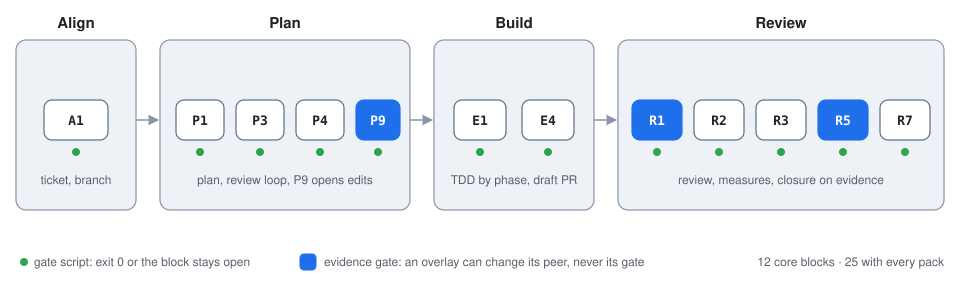

<div align="center">

# Cadence

**The model does not decide when the work is done. The gates do.**

A plan-to-PR harness for coding agents. Hooks and gate scripts hold the agent to one order (plan,
review, test-first build, draft PR, review closure), and every step fails closed when its
evidence is missing.

[](https://github.com/jtouley/cadence-core/actions/workflows/ci.yml)
[](LICENSE)
[](pyproject.toml)
[](AGENTS.md#setup)

[Quickstart](docs/quickstart.md) · [Configuration](docs/configuration.md) · [Peer contract](docs/peer-output-contract.md) · [Docs](docs/index.md) · [Contributing](CONTRIBUTING.md)

</div>

<p align="center">
  
</p>

## Why Cadence

A coding agent that writes "fixed it" has not shown that it fixed anything. An instruction that
says "write the test first" is a request, not a rule. Most agent workflows today are prompts and
templates: they guide the agent well, and they trust it to follow.

Cadence moves the rules out of the prompt and into code that the host runs:

- **A gate decides when a block is done.** Each block has a gate script. Exit 0, or the block stays
  open. A gate that cannot read its evidence fails.
- **Hooks hold the order.** The edit guard denies a code edit until the plan passed review. The stop
  guard sends the agent back to the open block instead of letting it stop to ask.
- **Findings close on evidence.** Every must-fix finding is a ledger row with a check that names a
  test. Only `ledger_verify.py` marks a row `verified`, after that check passes at `HEAD`.

## How it works

You give the agent one change. It walks the blocks of [`stages.json`](stages.json) and asks you
nothing until the draft PR is reviewed.

1. **Align.** Activate a run for one ticket, on its own branch.
2. **Plan.** Write the plan. A review peer judges it, and the plan loop runs until the review says
   `READY TO EXECUTE` (at most five cycles). Then the `entry-invariant` gate (P9) opens code edits.
3. **Build.** Implement the plan phase by phase, test first, one commit per phase. Open a draft PR.
4. **Review.** A review peer reviews the PR. The measured gates check test shape, duplication,
   code shape and complexity. Each must-fix goes in the ledger, gets a fix commit and a passing
   check. The closure gate (R5) passes only on that evidence. With every pack on, a re-review of
   the fixes and a closure comment on the PR come next.

The run stops early only for a hard stop: destructive risk, missing credentials, a security risk,
or no retries left.

## Quickstart

**See it without a model.** The toy run takes one ticket through the real gates and hooks on a
throwaway repository. It needs Python 3.11+ and git, and no network.

```bash
git clone https://github.com/jtouley/cadence-core.git && cd cadence-core
python3 examples/toy-run/run.py
```

<p align="center">
  
</p>

<details>
<summary>The same output as text</summary>

```text
== The edit guard, before the plan passed review
  Edit src/toy_pkg/core.py                     DENY
    BLOCKED: gated path `src/toy_pkg/core.py` requires entry invariant (...)
  Edit README.md                               allow
[...]
  The agent sets it to verified:               exit 1  error: status 'verified' not settable here (...)
  The agent sets it to fixed, with no commit:  exit 1  error: status=fixed requires fixed_in (...)
```

</details>

**Run it for real.** Install, then start a run in the repository you want to change:

```text
/plugin marketplace add jtouley/cadence-core
/plugin install cadence@cadence-core
```

```text
/cadence:cadence Add monthly budgets to the CLI. Ticket #12.
```

A plugin namespaces its skills, so the plugin install names the skill `/cadence:cadence`. With an
`install.sh` install it is `/cadence`. The [quickstart](docs/quickstart.md) walks a full run, host
by host.

## Install

| Host | How | Hooks |
|---|---|---|
| Claude Code | `/plugin marketplace add jtouley/cadence-core`, then `/plugin install cadence@cadence-core` | `hooks/hooks.json` |
| Cursor | `git clone https://github.com/jtouley/cadence-core.git ~/Projects/cadence-core && ~/Projects/cadence-core/install.sh` | `hooks/hooks-cursor.json` |
| Pi | The same `install.sh` | `pi/cadence-gates.ts` runs the hooks |
| Any other host | Run `python3 scripts/headless.py next` between steps | none: the gates still decide |

`install.sh` writes only under `$HOME`, and it is safe to run again. `./install.sh --tools` fills the
`uv` cache with the two pinned tools (ruff, mypy) that the `bugs` and `types` measures use, and puts
nothing on `PATH`.

A user-level command or skill with the name of a Cadence peer is a peer shadow: the host runs it
instead of the peer. The A2 preflight fails on a peer shadow and names each entry, and `install.sh`
prints the same list. Rename or remove each one. On a plugin install, do not run `install.sh`.
Start a new host session before you continue the run.

## Make it yours

Core holds no personal setup. You change Cadence with config, and you add to it with packs and
peers.

| You want to | Use |
|---|---|
| Pick how much process a run gets | `profile`: `minimal`, `standard` (the default, 12 blocks) or `strict` (every pack, 25 blocks) |
| Tighten a limit | Any limit key, such as `review_fix_rounds` or `cognitive_complexity.max`. A layer can make a limit stricter, never looser |
| Add an org rule that judges the plan or the code | A [pack](references/pack-standard.md) with a gate in any language, pinned in `cadence.lock.json` |
| Add, remove or change a block | `stages.overlays`, by block id. P9, R1 and R5 keep their gates |
| Run your own planner or reviewer | `peers.<block>`, set to another plugin's skill. It writes the [peer output contract](docs/peer-output-contract.md) |

Config is a stack of JSON layers: core defaults, a profile, `~/.config/cadence/config.json`, the
repo's `.cadence.json`, a git-ignored `.cadence.local.json`, and `CADENCE_*` variables. A
`.cadence.json` in your repository:

```json
{
  "$schema": "https://raw.githubusercontent.com/jtouley/cadence-core/main/references/cadence.config.schema.json",
  "packs": {"append": ["architecture"]},
  "gated_prefixes": {"append": ["services/"]},
  "peers": {"R1": "my-skills:pr-review"},
  "review_fix_rounds": 1
}
```

A key that the [schema](references/cadence.config.schema.json) does not know, a wrong type, or a file
that does not parse stops the gate and names the file. `python3 scripts/cadence_config.py resolve`
prints every value and the layer that set it. The full reference is
[docs/configuration.md](docs/configuration.md).

## How it compares

We read Superpowers, Spec Kit, OpenSpec, GSD Core and BMAD at pinned commits. They are good tools
with wider host support than Cadence. The difference is where the process lives.

| | Process lives in | What stops a skipped step | Hosts |
|---|---|---|---|
| **Cadence** | Gate scripts and host hooks | The hook denies the call, or the gate keeps the block open | Claude Code, Cursor, Pi, and any shell |
| Spec Kit | Prompt templates and a workflow engine | Gate steps in its own workflow runner. Hook `requires` is advisory | About 40 |
| OpenSpec | Prompts, and a `validate` command | `openspec validate`. "No phase gates" by design | About 35 |
| GSD Core | Prompts, and mostly advisory hooks | A few hard-blocking hooks. Most guards advise | 10+ |
| BMAD | Prompts and per-skill options | Nothing outside the prompt | Through the skills CLI |
| Superpowers | Skills, and a session-start hook | Nothing outside the prompt | About 15 |

Pick Cadence when "done" must mean done and you want the order enforced, and you accept a heavier
run for it. Pick a lighter tool for exploration, or when your host cannot run a hook.

**When not to use Cadence:** you can review the change yourself in a minute, the repository has no
tests, or the host cannot run a hook or a CLI gate before each edit. A default run calls three
review peers before a person sees the PR.

## Docs

| Start here | Reference | Background |
|---|---|---|
| [Quickstart](docs/quickstart.md) | [Configuration](docs/configuration.md) | [System design](docs/system-design.md) |
| [Toy run](examples/toy-run/README.md) | [Peer output contract](docs/peer-output-contract.md) | [Gate pattern for other hosts](docs/gate-pattern.md) |
| [Testing](docs/testing.md) | [Pack standard](references/pack-standard.md) | [Contributing](CONTRIBUTING.md) |

Everything else is in the [docs index](docs/index.md).

## Status

Cadence core is pre-1.0. The gates, the hooks and the config schema are tested on every pull
request, on Linux and macOS, with Python 3.11 and 3.13. A key or a pack field can still change
before 1.0; [CHANGELOG.md](CHANGELOG.md) names each change.

## Contributing

Contributions that make core safer, smaller or easier to configure are welcome. Org rules and
personal workflows belong in a pack or a plugin, not in core. Read [CONTRIBUTING.md](CONTRIBUTING.md)
and [AGENTS.md](AGENTS.md) before you open a pull request. To report a security problem, see
[SECURITY.md](SECURITY.md).

## License

MIT. See [LICENSE](LICENSE).
